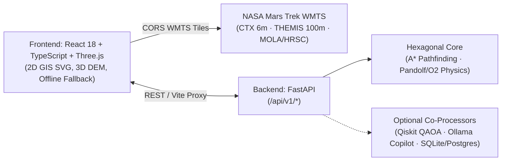

<div align="center">

# 🚀 SENDA — Safe Paths to Martian Science

**Pressurized Rover (SEV) Traverse & xEMU EVA Mission Planning System for Mount Sharp, Gale Crater**

[](https://senda1.netlify.app/)
[](https://science.nasa.gov/mission/msl-curiosity/)
[](https://trek.nasa.gov/mars/)
[](frontend/)
[](backend/)
[](frontend/src/features/terrain/components/Terrain3DView.tsx)
[](backend/src/senda/adapters/quantum_qiskit.py)

**Standalone-capable NASA Mission Control web application** with an independent hexagonal **FastAPI** backend and **React + Three.js** frontend.

</div>

---

## 🧭 Mission Overview

**SENDA** (*Safe Paths to Martian Science*) is an end-to-end surface mission planner and field operations simulator designed around **NASA's Gale Crater Exploration Zone** (`137.42009295°E, -4.59310427°S, -4497.77 m MOLA`, `25 km` / `100 km` EZ). It enables flight controllers and surface crews to:

1. **Select & Prioritize Science Targets** across Mount Sharp's stratigraphic units using a 15-point NASA habitability/novelty/human-only rubric.
2. **Plan Pressurized Rover (SEV) Traverses & xEMU Spacewalks (EVAs)** with 8-neighbor **A\*** terrain-aware pathfinding, comparing **Safe**, **Scientific**, and **Fast** Pareto-optimal alternatives.
3. **Evaluate Environmental Readiness (`GO / NO-GO`)** against live **MSL Curiosity REMS & RAD** conditions (dust opacity $\tau$, diurnal temperature, atmospheric pressure, and Solar Particle Event radiation flares).
4. **Execute Live Field Simulations** with dynamic contingencies (*Dust Storm*, *SPE / Blocked Path*, *Suit Leak*), real-time O₂/battery margins, **1,000-run Monte Carlo** risk analysis, and **exportable Mission Dossiers** (`JSON`, `CSV`, `GeoJSON`, `PDF`).

---

## 🛰️ Verified NASA Datasets & Planetary Science Integration

SENDA grounds its 2D GIS layers, 3D terrain, and environmental telemetry in official NASA/USGS planetary data:

| Domain | Dataset / Instrument | Resolution / Range | Usage in SENDA |
|---|---|---|---|
| **Orbital Imagery** | **NASA Mars Trek WMTS** (`Gale_CTX_BlockAdj_dd`, fallback `Mars_Viking_MDIM21_ClrMosaic_global_232m`) | `6 m/px` (zoom 11) | Georeferenced MRO CTX orbital basemap over Gale Crater |
| **Thermal / Mineralogy** | **MO THEMIS-IR Day** (`THEMIS_DayIR_ControlledMosaics_100m_v2_oct2018`) + **Mount Sharp Strata** | `100 m/px` (zoom 9) | Thermal-inertia overlay + *Murray*, *Glen Torridon*, *Stimson*, & *Sulfate Boxwork* units |
| **Topography & Relief** | **MGS MOLA + Mars Express HRSC** (`Mars_MOLA_blend200ppx_HRSC_ClrShade_clon0dd_200mpp_lzw`) & **MSL Gale Merged DEM** (`main`) | `200 m/px` / `1 m` DEM | Elevation, slope hazard (`>10°` / `>18°`), and horizon radiation shielding |
| **Surface Weather (REMS)** | **MSL Curiosity REMS** | `-90 °C` to `+6 °C` · `680–1150 Pa` | Diurnal thermal curve, dust opacity ($\tau$), and SEV range modeling |
| **Radiation (RAD)** | **MSL Curiosity RAD** | `0.64–0.67 mSv/sol` GCR (`1.85 mSv/sol` SPE) | Daily crew dose tracking, cliff-wall shelter pockets, and SPE cabin abort triggers |

---

## ✨ Key Capabilities

- **2D GIS + Interactive 3D DEM (`Three.js`):** 8 toggleable geospatial layers (*Terrain*, *Slope*, *Science targets*, *Routes*, *Danger zones*, *Orbital photo*, *Minerals*, *Radiation shelter*) plus interactive 3D terrain visualization with `ORBIT`, `CHASE`, `POV`, `DRONE`, and `FLYOVER` camera modes.
- **Crew & Suit Health HUD:** Configurable crew roster, callsigns, and suit telemetry (`xEMU-01` / `xEMU-02`) with live `HelmetStatusCard` biometrics and `MSR-Ti` sample cache logging.
- **NASA Labs Suite:**
  - **1,000-Run Monte Carlo Simulator:** Evaluates mission success probability under dust storm ($\tau$) and radiation (`SPE`) uncertainty.
  - **RIMFAX GPR & SHERLOC Raman Views:** Subsurface stratigraphy and mineral/organic spectroscopy inspection per target.
- **Instant Demo & Export:** One-click **`▶ Quick Demo`** and **`Reset`** controls, unified mission score (`0–100`, Grade `A+–D`), and export to **JSON**, **CSV**, **GeoJSON**, and **Print / PDF Mission Dossier**.
- **SENDA Copilot & Mission Calendar (`main` branch):** Natural-language mission planner powered by local **Ollama (`qwen3:1.7b`)** with automatic fallback, plus SQLite/Postgres sol-by-sol plan persistence.
- **Optional IBM Quantum QAOA Co-Processor:** Browser-native Statevector QAOA simulator plus optional backend bridge to **Qiskit AerSimulator** and **IBM Quantum Runtime** (`ibm_brisbane`, `ibm_torino`, `ibm_fez`) with $T_1/T_2$ noise modeling. Core NASA planning remains **100% standalone** without Qiskit.

---

## 🏗️ System Architecture



### Repository Layout

```text
senda-mars/
├── backend/
│   ├── data/                     # Science targets GeoJSON, environment, terrain & knowledge base
│   ├── src/senda/
│   │   ├── domain/               # Pure Python models, A* pathfinding, Pandolf & O2 physics
│   │   ├── application/          # Use cases & outbound ports (Protocol interfaces)
│   │   ├── adapters/             # FastAPI routers, JSON/DEM/SQL/LLM/Qiskit adapters
│   │   ├── config.py             # Environment settings
│   │   ├── container.py          # Composition root
│   │   └── main.py               # FastAPI entrypoint
│   └── tests/                    # Unit & FastAPI TestClient integration tests
├── frontend/
│   └── src/
│       ├── app/                  # Root shell & NASA JPL Mission Control theme
│       ├── pages/                # GlobePage & MissionControlPage
│       ├── features/             # mission, layers, route-planning, field-simulation, map, terrain, targets, environment, globe
│       └── shared/               # httpClient (with offline fallback), geo/astar libs, UI primitives
└── scripts/                      # setup.py and dev.py
```

---

## ⚡ Quick Start

- **🌐 Live Demo (Standalone Web App):** https://senda1.netlify.app/

**Local Prerequisites:** Python 3.11+ and Node.js 20+.

```bash
git clone https://github.com/JhonAlex28/senda-mars.git
cd senda-mars
python scripts/setup.py   # One-time setup: creates backend/.venv and installs dependencies
python scripts/dev.py     # Starts FastAPI (port 8000) + Vite (port 5173)
```

- **Web App:** `http://localhost:5173`
- **Swagger API Docs:** `http://localhost:8000/docs`

> **Standalone Mode:** The frontend includes a full client-side A\* & physics fallback (`shared/api/localFallback.ts`), so every planning, 3D, NASA Labs, and export workflow runs even without a live backend.

<details>
<summary><strong>Manual Backend, Frontend & Optional Add-on Commands</strong></summary>

### Backend
```powershell
cd backend
python -m venv .venv
.venv\Scripts\activate
pip install -e ".[dev]"
# Optional Qiskit + IBM Quantum Runtime:
# pip install -e ".[quantum]"   # Put IBM_QUANTUM_TOKEN=... in backend/.env (never commit tokens)
pytest
uvicorn senda.main:app --reload
```

### Frontend
```powershell
cd frontend
npm.cmd install
npm.cmd run dev        # http://localhost:5173 (proxies /api -> localhost:8000)
npm.cmd run typecheck  # tsc -b
npm.cmd run build      # Production bundle
```

### Key API Endpoints
| Endpoint | Description |
|---|---|
| `GET /health` | Service health check |
| `GET /api/v1/targets` | Gale Crater science targets & sampling protocols |
| `GET /api/v1/environment/readiness` | `GO / CAUTION / NO-GO` environmental assessment |
| `GET /api/v1/terrain?cell_size_m=` | Elevation & slope grid for the site or EVA window |
| `POST /api/v1/routes/traverse` | Pressurized Rover traverse (3 Pareto alternatives) |
| `POST /api/v1/routes/eva` | xEMU EVA walking routes from active parking site |
| `POST /api/v1/routes/path` | Dynamic waypoint contingency / return-to-base path |
| `POST /api/v1/quantum/optimize-route` | *(Optional)* QAOA target sequence optimizer |

</details>

---

## 👥 Team & Collaboration

- See **[CONTRIBUTING.md](CONTRIBUTING.md)** for branching conventions, Pull Request workflow, and module ownership.
- **Repository:** https://github.com/JhonAlex28/senda-mars
